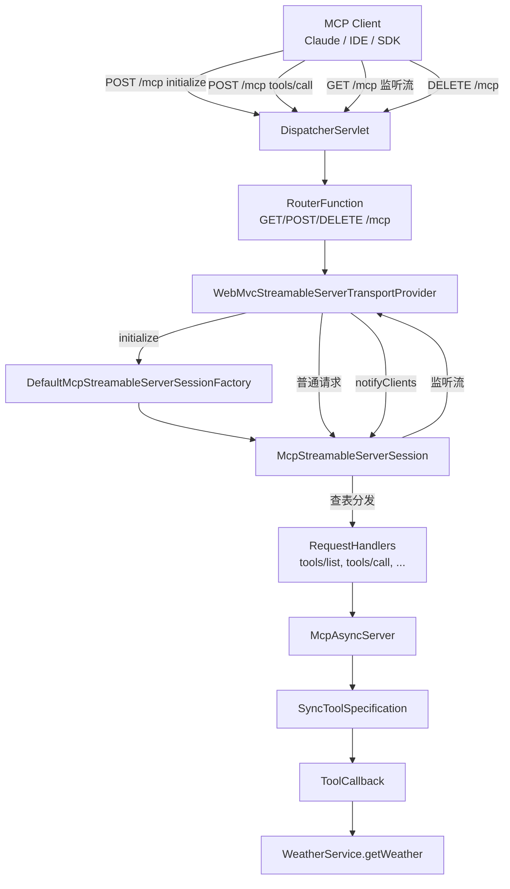
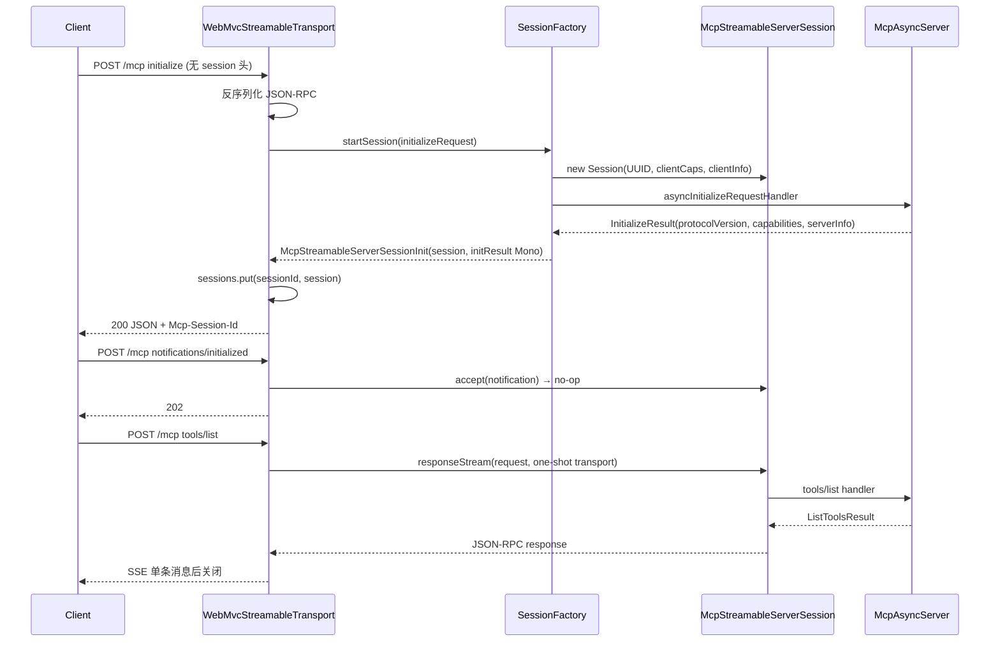
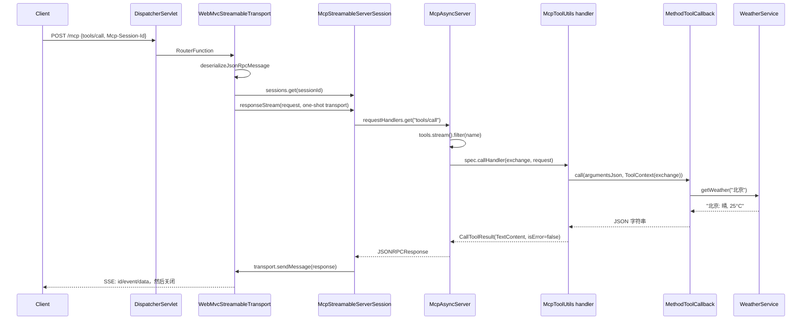

# Spring AI MCP Server（Streamable HTTP）源码深度解析

> 分析对象：`spring-ai-starter-mcp-server-webmvc:1.1.8`（Spring AI 1.1.8 + MCP Java SDK 0.18.3 + Spring Boot 3.5.6）
>
> 分析方式：对本地 Maven 仓库中的官方 jar 做反编译阅读，并实际启动本 Demo、用 `curl` 完整走通 MCP 协议。
>
> 说明：文中的代码片段为便于阅读做过简化（去掉反编译产生的原始类型、强制转换和合成方法），方法名、类名、调用关系与字节码一致。

---

## 0. 一页速览

1. **Spring AI 本身不实现 MCP 协议**。它只做三件事：把 Spring 容器里的 `ToolCallback` 适配成 MCP 的 `ToolSpecification`；把 MCP SDK 的 `McpServer` 装配成 Spring Bean；把 Servlet 容器接到 SDK 的 Transport 上。真正的协议引擎在 `io.modelcontextprotocol.sdk:mcp-core`。
2. **自动配置是三条正交条件的组合**：`protocol`（SSE / STREAMABLE / STATELESS）、`stdio`（true / false）、`type`（SYNC / ASYNC）。不同组合激活不同的 Transport + Server Bean。
3. **Streamable HTTP 不是“另一种 SSE”**，而是“一个端点 + 会话头 + 按需 SSE”：`POST /mcp`、`GET /mcp`、`DELETE /mcp` 三个方法共用同一路径，用 `Mcp-Session-Id` 维持逻辑会话。
4. **工具注册链路**是：`@Tool` 方法 → `MethodToolCallbackProvider` → `ToolCallback` → `ToolCallbackConverterAutoConfiguration` 聚合成 `List<SyncToolSpecification>` → `McpToolUtils` 包装成 MCP Tool + callHandler → `McpAsyncServer` 的 `tools/list` / `tools/call` 处理器。
5. **SYNC Server 是 ASYNC Server 的阻塞门面**，不存在第二套协议实现；Servlet 环境下通过 `immediateExecution(true)` 让同步工具直接在 Servlet 线程执行。
6. **0.18.3 的 Streamable 断线续传实际上不可用**：`McpStreamableServerSession.replay()` 直接返回 `Flux.empty()`，`Last-Event-ID` 分支也不会注册监听流。
7. **会话全在内存**：`ConcurrentHashMap` 保存，只有 `DELETE` 或应用关闭才移除；没有空闲超时、没有持久化、没有跨实例共享。多实例部署必须做粘性会话。
8. **默认没有鉴权、没有 Origin/Host 校验**；`ServerTransportSecurityValidator` 默认是 NOOP。传输层的错误响应（如缺 Session 头）还会把整段 Java 堆栈序列化给客户端，这是源码里非常值得注意的“坑”。

---

## 1. 分析对象与依赖链

### 1.1 Demo 工程

本工程是一个最小可运行示例：

```java
@SpringBootApplication
public class App {
    public static void main(String[] args) {
        SpringApplication.run(App.class, args);
    }

    @Bean
    public ToolCallbackProvider weatherTools(WeatherService weatherService) {
        return MethodToolCallbackProvider.builder()
                .toolObjects(weatherService)
                .build();
    }
}
```

```java
@Component
public class WeatherService {
    @Tool(name = "getWeather", description = "根据城市名称查询天气信息", returnDirect = true)
    public String getWeather(String city) {
        return switch (city) {
            case "北京" -> "北京: 晴, 25°C";
            case "上海" -> "上海: 多云, 22°C";
            case "深圳" -> "深圳: 小雨, 28°C";
            default -> city + ": 下雪, -20°C";
        };
    }
}
```

```yaml
spring:
  ai:
    mcp:
      server:
        protocol: streamable
        name: streamable-mcp-server-demo
        version: 1.0.0
        streamable-http:
          mcp-endpoint: /mcp
```

配置的关键点只有两个：`protocol: streamable` 和 `mcp-endpoint: /mcp`。其余全部走默认值。

### 1.2 依赖链

`spring-ai-starter-mcp-server-webmvc` 是一个“聚合 POM”，真正的代码分布如下：

```text
spring-ai-starter-mcp-server-webmvc:1.1.8
├── spring-ai-autoconfigure-mcp-server-webmvc:1.1.8
│   └── spring-ai-autoconfigure-mcp-server-common:1.1.8   ← 自动配置核心
├── spring-ai-mcp:1.1.8                                   ← Spring AI 适配层（McpToolUtils 等）
├── spring-ai-mcp-annotations:1.1.8                       ← @McpTool/@McpResource 注解扫描
├── io.modelcontextprotocol.sdk:mcp-spring-webmvc:0.18.3   ← WebMVC Transport
│   ├── mcp:0.18.3                                        ← 聚合模块（协议实现主要在 mcp-core）
│   ├── mcp-core:0.18.3                                   ← Server / Schema / Session / Transport 抽象
│   └── mcp-json-jackson2:0.18.3                          ← Jackson JSON Mapper + Schema Validator
└── spring-boot-starter-web:3.5.6                         ← Servlet + Tomcat
```

> 注：starter 的 POM 里声明的是 Boot 3.5.15，但本工程父 POM 是 3.5.6，`dependencyManagement` 会把实际版本压回 3.5.6。

### 1.3 本文所谓“源码”的边界

- Spring AI 侧：`spring-ai-autoconfigure-mcp-server-common`、`spring-ai-autoconfigure-mcp-server-webmvc`、`spring-ai-mcp`。
- 协议侧：`mcp-core`、`mcp`、`mcp-spring-webmvc`、`mcp-json-jackson2`（MCP Java SDK 0.18.3）。
- Spring 容器侧：`spring-webmvc` 的 `ServerResponse.sse` 实现（用于解释阻塞/异步模型）。

---

## 2. 分层架构

### 2.1 三层模型

| 层 | 职责 | 代表类 |
|---|---|---|
| Spring AI 适配层 | 把 Spring AI 的 `ToolCallback`/注解转成 MCP `ToolSpecification`；把 SDK Server 装配成 Bean | `McpServerAutoConfiguration`、`ToolCallbackConverterAutoConfiguration`、`McpToolUtils` |
| MCP SDK 协议层 | JSON-RPC 分发、能力协商、会话、请求处理器、反向请求 | `McpServer`、`McpAsyncServer`、`McpStreamableServerSession`、`McpServerSession` |
| WebMVC 传输层 | 把 HTTP 请求映射成 JSON-RPC 消息，把响应写成 JSON 或 SSE | `WebMvcStreamableServerTransportProvider`、`SseServerResponse` |

一句话：**Spring AI 负责“装配”，SDK 负责“协议”，Spring MVC 负责“搬运”**。

### 2.2 架构图



### 2.3 启动后的关键 Bean

| Bean 名称 | 类型 | 创建者 | 作用 |
|---|---|---|---|
| `mcpServerObjectMapper` | `ObjectMapper` | `McpServerObjectMapperAutoConfiguration` | MCP 专用 Jackson 配置（NON_NULL、忽略未知字段、不写时间戳） |
| `webMvcStreamableServerTransportProvider` | `WebMvcStreamableServerTransportProvider` | `McpServerStreamableHttpWebMvcAutoConfiguration` | 三种 HTTP 方法的实际处理器，持有会话表 |
| `webMvcStreamableServerRouterFunction` | `RouterFunction<ServerResponse>` | 同上 | 注册到 Spring MVC 的 `RouterFunctionMapping` |
| `capabilitiesBuilder` | `McpSchema.ServerCapabilities.Builder` | `McpServerAutoConfiguration` | 汇总各能力开关 |
| `syncTools` | `List<McpServerFeatures.SyncToolSpecification>` | `ToolCallbackConverterAutoConfiguration` | 把 `ToolCallback` 转成 MCP 工具描述 |
| `mcpSyncServer` | `McpSyncServer` | `McpServerAutoConfiguration` | 对外的 MCP Server 门面 |
| `servletMcpSyncServerCustomizer` | `McpSyncServerCustomizer` | `McpServerAutoConfiguration` | 设置 `immediateExecution(true)` |
| `stdioServerTransport` | `StdioServerTransportProvider` | `McpServerAutoConfiguration` | 兜底 Transport，Web 场景下会退让 |

补充：Spring Boot 的 `RouterFunctionMapping` 会自动发现容器里的 `RouterFunction` Bean，把它注册到 `DispatcherServlet`。所以本 Demo 没有 `@RestController`、没有 `@RequestMapping`，`/mcp` 完全由函数式端点接管。

---

## 3. 自动配置：Bean 是怎么装起来的

### 3.1 AutoConfiguration.imports

`spring-ai-autoconfigure-mcp-server-webmvc` 的 `META-INF/spring/org.springframework.boot.autoconfigure.AutoConfiguration.imports` 只注册了三个 Web 传输配置：

```text
org.springframework.ai.mcp.server.autoconfigure.McpServerSseWebMvcAutoConfiguration
org.springframework.ai.mcp.server.autoconfigure.McpServerStreamableHttpWebMvcAutoConfiguration
org.springframework.ai.mcp.server.autoconfigure.McpServerStatelessWebMvcAutoConfiguration
```

公共配置在 `spring-ai-autoconfigure-mcp-server-common` 的 imports 中：

```text
org.springframework.ai.mcp.server.common.autoconfigure.McpServerAutoConfiguration
org.springframework.ai.mcp.server.common.autoconfigure.McpServerObjectMapperAutoConfiguration
org.springframework.ai.mcp.server.common.autoconfigure.ToolCallbackConverterAutoConfiguration
org.springframework.ai.mcp.server.common.autoconfigure.McpServerStatelessAutoConfiguration
org.springframework.ai.mcp.server.common.autoconfigure.StatelessToolCallbackConverterAutoConfiguration
org.springframework.ai.mcp.server.common.autoconfigure.annotations.McpServerSpecificationFactoryAutoConfiguration
org.springframework.ai.mcp.server.common.autoconfigure.annotations.StatelessServerSpecificationFactoryAutoConfiguration
org.springframework.ai.mcp.server.common.autoconfigure.annotations.McpServerAnnotationScannerAutoConfiguration
```

两者合起来，才是完整的 MCP Server 自动配置图。

### 3.2 条件矩阵

| 配置组合 | 激活的 Transport 配置 | 激活的 Server 配置 | 实际 Transport |
|---|---|---|---|
| `protocol=SSE`（默认）、`stdio=false` | `McpServerSseWebMvcAutoConfiguration` | `McpServerAutoConfiguration` | `WebMvcSseServerTransportProvider` |
| `protocol=STREAMABLE`、`stdio=false` | `McpServerStreamableHttpWebMvcAutoConfiguration` | `McpServerAutoConfiguration` | `WebMvcStreamableServerTransportProvider` |
| `protocol=STATELESS`、`stdio=false` | `McpServerStatelessWebMvcAutoConfiguration` | `McpServerStatelessAutoConfiguration` | `WebMvcStatelessServerTransport` |
| `stdio=true`、`protocol != STATELESS` | 三个 Web 配置全部关闭 | `McpServerAutoConfiguration` | `StdioServerTransportProvider` |
| `enabled=false` | 全部关闭 | 全部关闭 | 无 |
| `type=ASYNC` | 同上 | 创建 `McpAsyncServer` 而非 `McpSyncServer` | 同上 |

关键条件类：

- `McpServerStdioDisabledCondition`：`enabled=true` **且** `stdio=false`，Web Transport 才会生效。
- `McpServerAutoConfiguration.NonStatelessServerCondition`：`protocol=SSE` **或** `protocol=STREAMABLE`。
- `McpServerAutoConfiguration.EnabledSseServerCondition` / `EnabledStreamableServerCondition`：`enabled=true` 且对应协议。
- `McpServerStatelessAutoConfiguration.EnabledStatelessServerCondition`：`enabled=true` 且 `protocol=STATELESS`。

### 3.3 为什么不会出现两个 TransportProvider 冲突

`McpServerAutoConfiguration` 里有一个看起来“无条件”的 stdio 兜底 Bean：

```java
@Bean
@ConditionalOnMissingBean
public McpServerTransportProviderBase stdioServerTransport(
        @Qualifier("mcpServerObjectMapper") ObjectMapper objectMapper) {
    return new StdioServerTransportProvider(new JacksonMcpJsonMapper(objectMapper));
}
```

它没有写 `@ConditionalOnProperty`，看起来在 Web 场景也会创建。但它的 `@ConditionalOnMissingBean` 是按**方法返回类型** `McpServerTransportProviderBase` 判断的；而自动配置排序中，Streamable 配置声明了：

```java
@AutoConfiguration(before = McpServerAutoConfiguration.class)
```

因此 Streamable 的 `webMvcStreamableServerTransportProvider` 先注册，stdio 兜底 Bean 再评估时发现容器里已经有 `McpServerTransportProviderBase`，就自动退让。

启动时 `--debug` 的条件报告可以直接看到这一点：

```text
McpServerAutoConfiguration#stdioServerTransport:
   - @ConditionalOnMissingBean (types: io.modelcontextprotocol.spec.McpServerTransportProviderBase;
     SearchStrategy: all) found beans of type 'io.modelcontextprotocol.spec.McpServerTransportProviderBase'
     webMvcStreamableServerTransportProvider (OnBeanCondition)
```

同样的机制也保证了 SSE 与 Streamable 不会同时生效（两个配置的条件互斥）。

### 3.4 `mcpSyncServer` 源码逐步拆解

`McpServerAutoConfiguration#mcpSyncServer` 是整个装配过程的核心。简化后的逻辑：

```java
@Bean
@ConditionalOnProperty(prefix = "spring.ai.mcp.server", name = "type",
        havingValue = "SYNC", matchIfMissing = true)
public McpSyncServer mcpSyncServer(
        McpServerTransportProviderBase transportProvider,
        McpSchema.ServerCapabilities.Builder capabilitiesBuilder,
        McpServerProperties serverProperties,
        McpServerChangeNotificationProperties changeNotificationProperties,
        ObjectProvider<List<McpServerFeatures.SyncToolSpecification>> tools,
        ObjectProvider<List<McpServerFeatures.SyncResourceSpecification>> resources,
        ObjectProvider<List<McpServerFeatures.SyncResourceTemplateSpecification>> resourceTemplates,
        ObjectProvider<List<McpServerFeatures.SyncPromptSpecification>> prompts,
        ObjectProvider<List<McpServerFeatures.SyncCompletionSpecification>> completions,
        ObjectProvider<BiConsumer<McpSyncServerExchange, List<McpSchema.Root>>> rootsChangeConsumers,
        Optional<McpSyncServerCustomizer> customizer) {

    McpSchema.Implementation serverInfo =
            new McpSchema.Implementation(serverProperties.getName(), serverProperties.getVersion());

    // 关键分叉：Streamable 与单会话 Transport 使用不同的 Builder 重载
    McpServer.SyncSpecification<?> builder =
            transportProvider instanceof McpStreamableServerTransportProvider
                    ? McpServer.sync((McpStreamableServerTransportProvider) transportProvider)
                    : McpServer.sync((McpServerTransportProvider) transportProvider);

    builder.serverInfo(serverInfo);

    if (serverProperties.getCapabilities().isTool()) {
        capabilitiesBuilder.tools(changeNotificationProperties.isToolChangeNotification());
        List<SyncToolSpecification> specs = tools.stream()
                .flatMap(Collection::stream).toList();
        if (!specs.isEmpty()) {
            builder.tools(specs);
        }
    }

    // resources / resourceTemplates / prompts / completions 同理……

    builder.capabilities(capabilitiesBuilder.build());
    builder.instructions(serverProperties.getInstructions());
    builder.requestTimeout(serverProperties.getRequestTimeout());
    customizer.ifPresent(c -> c.customize(builder));   // Servlet 场景注入 immediateExecution(true)
    return builder.build();
}
```

这里有四个容易忽略的点：

1. **`instanceof` 分叉决定会话模型**
   - `McpStreamableServerTransportProvider` → `McpServer.sync(streamable)` → 使用 `DefaultMcpStreamableServerSessionFactory`，每个 `initialize` 建一个 `McpStreamableServerSession`。
   - 普通 `McpServerTransportProvider`（SSE / stdio）→ `McpServer.sync(transportProvider)` → 使用 `McpServerSession`，一个 Transport 一个会话。

2. **能力开关与“是否真的有实现”无关**
   只要 `spring.ai.mcp.server.capabilities.tool=true`，即使一个工具都没注册，`tools` 能力仍会被写进 `InitializeResult`。本 Demo 只注册了 1 个工具，但 `prompts`、`resources`、`completions` 也都被宣告了（见实测响应），因为默认全为 true。

3. **`resources` 和 `resourceTemplates` 共用一个能力开关**
   两段代码都判断 `isResource()`，都会调用 `capabilitiesBuilder.resources(false, ...)`，第二次调用只是覆盖同样的值。

4. **`ObjectProvider<List<...>>` 支持多来源**
   `tools.stream().flatMap(Collection::stream)` 会把容器里所有 `List<SyncToolSpecification>` Bean 摊平。这既包括 `ToolCallbackConverterAutoConfiguration#syncTools`，也包括注解扫描产生的 `toolSpecs`，还包括用户自己定义的 Bean。

### 3.5 三个“隐藏行为”

#### 行为一：`logging` 能力总是存在

`McpAsyncServer` 构造时无条件执行：

```java
this.serverCapabilities = features.serverCapabilities().mutate().logging().build();
```

所以即使 `spring.ai.mcp.server.capabilities` 里根本没有 logging 开关，`InitializeResult.capabilities.logging` 也永远是 `{}`，并且 `logging/setLevel` 处理器永远会注册。这是 SDK 层的硬编码行为，不是 Spring AI 配置能关掉的。

#### 行为二：`listChanged` 来自独立的配置前缀

`McpServerChangeNotificationProperties` 和 `McpServerProperties` 都绑定 `spring.ai.mcp.server` 前缀，所以：

```yaml
spring.ai.mcp.server.tool-change-notification: false
```

会同时影响 `capabilities.tools.listChanged` 和动态增删工具时是否发送 `notifications/tools/list_changed`。

#### 行为三：`McpSchema.ServerCapabilities.Builder` 是单例 Bean

它被 `mcpSyncServer`、`mcpAsyncServer`、`McpServerStatelessAutoConfiguration` 共享。正常单服务器配置下没问题；如果同一个容器里手动创建多个 Server，建议各自 `new` 一个 Builder，避免复用同一个实例导致能力字段相互覆盖。

### 3.6 自定义 ObjectMapper

`McpServerObjectMapperAutoConfiguration` 创建了一个**非主候选**的 `mcpServerObjectMapper`：

```java
@Bean(name = "mcpServerObjectMapper", defaultCandidate = false)
public ObjectMapper mcpServerObjectMapper() {
    return JsonMapper.builder()
            .disable(DeserializationFeature.FAIL_ON_UNKNOWN_PROPERTIES)
            .enable(DeserializationFeature.ACCEPT_EMPTY_STRING_AS_NULL_OBJECT)
            .disable(SerializationFeature.FAIL_ON_EMPTY_BEANS)
            .disable(SerializationFeature.WRITE_DATES_AS_TIMESTAMPS)
            .serializationInclusion(JsonInclude.Include.NON_NULL)
            .addModules(JacksonUtils.instantiateAvailableModules())
            .build();
}
```

所以：

- `null` 字段不会出现在 JSON 里（`outputSchema`、`title`、`annotations` 缺失就是这个原因）。
- 未知字段被忽略，便于协议向前兼容。
- 自定义它只需自己定义一个同名 Bean，`@ConditionalOnMissingBean(name = "mcpServerObjectMapper")` 会自动退让。

### 3.7 两个 ObjectMapper：Transport 与 Server 内核并不共享

这是源码里一个很容易被忽略的细节：

- `McpServerStreamableHttpWebMvcAutoConfiguration` 把 `mcpServerObjectMapper` 传给了 Transport：

  ```java
  WebMvcStreamableServerTransportProvider.builder()
          .jsonMapper(new JacksonMcpJsonMapper(objectMapper))
          ...
  ```

- 但 `McpServerAutoConfiguration` 在构建 Server 时**没有**调用 `serverBuilder.jsonMapper(...)`。`McpServer.SyncSpecification.build()` 里：

  ```java
  McpJsonMapper jsonMapper = this.jsonMapper == null
          ? McpJsonDefaults.getMapper()
          : this.jsonMapper;
  ```

  `McpJsonDefaults` 通过 `ServiceLoader` 找到 `mcp-json-jackson2` 提供的 `JacksonMcpJsonMapperSupplier`，它创建的是一个 **全新的、默认配置的 `new ObjectMapper()`**。

因此实际存在两套 Jackson：

| 用途 | 使用的 Mapper |
|---|---|
| Transport 层：JSON-RPC 文本 ↔ `McpSchema` 对象、SSE 序列化 | Spring 的 `mcpServerObjectMapper` |
| Server 内核：`tools/call` 等 handler 的 `params -> XXXRequest` 转换 | SDK 默认 `new ObjectMapper()` |

影响：

- 你在 `mcpServerObjectMapper` 上注册的模块/配置，**不会**自动作用于 `McpAsyncServer` 内部的 `convertValue`。
- 对 `CallToolRequest` 这种简单结构通常无感（`arguments` 只是 `Map`），但如果你依赖自定义反序列化器、日期格式、命名策略，就需要注意。
- 想让 Server 内核也使用自定义 Mapper，可以在 `McpSyncServerCustomizer` 里显式调用 `builder.jsonMapper(...)`，把同一个（或自定义的）`McpJsonMapper` 传给 Server 内核。

---

## 4. 从 `@Tool` 到 `tools/list`

Spring AI 的 `ToolCallback` 是面向“模型调用”的抽象，MCP 只是它的一个出口。这样同一个 `@Tool` 方法既可以给 `ChatClient` 做 function calling，也可以暴露成 MCP 工具，不必维护两套定义。代价是抽象层多、字段有损（例如 `outputSchema`、`returnDirect` 不会完整传递）。

### 4.1 第一跳：`MethodToolCallbackProvider`

`McpToolUtils` 不负责扫描注解。真正把 `@Tool` 方法变成 `ToolCallback` 的是 Spring AI Model 模块里的 `MethodToolCallbackProvider`：

```java
public ToolCallback[] getToolCallbacks() {
    return toolObjects.stream()
            .map(obj -> Stream.of(ReflectionUtils.getDeclaredMethods(
                            AopUtils.isAopProxy(obj) ? AopUtils.getTargetClass(obj) : obj.getClass()))
                    .filter(this::isToolAnnotatedMethod)
                    .filter(m -> !isFunctionalType(m))
                    .map(m -> MethodToolCallback.builder()
                            .toolDefinition(ToolDefinitions.from(m))
                            .toolMetadata(ToolMetadata.from(m))
                            .toolMethod(m)
                            .toolObject(obj)
                            .toolCallResultConverter(ToolUtils.getToolCallResultConverter(m))
                            .build())
                    .toArray(ToolCallback[]::new))
            .flatMap(Stream::of)
            .toArray(ToolCallback[]::new);
}
```

这里有几个约束：

- 只扫描**声明方法**（`getDeclaredMethods`），不扫描父类/接口默认方法。
- AOP 代理会取目标类，所以 `@Transactional` 代理不影响工具发现。
- 返回 `Function` / `Supplier` / `Consumer` 的方法会被忽略（只打 WARN）。
- 同一批 `toolObjects` 内工具名重复会直接抛异常。
- `ToolDefinitions.from(m)` 会生成 `name`、`description`、`inputSchema`。

### 4.2 JSON Schema 生成

`ToolDefinitions` 调用 `JsonSchemaGenerator.generateForMethodInput(method)`，底层是 victools 的 `jsonschema-generator`。本 Demo 的 `getWeather(String city)` 生成结果是：

```json
{
  "type": "object",
  "properties": {
    "city": { "type": "string" }
  },
  "required": ["city"],
  "additionalProperties": false
}
```

注意：

- 参数名来自字节码的 `MethodParameters` / `LocalVariableTable`。Spring Boot 父 POM 默认给 `maven-compiler-plugin` 加了 `-parameters`，所以 `city` 能保留；如果项目覆盖了编译参数，可能退化成 `arg0`。
- `ToolContext` 类型的参数会被 `MethodToolCallback` 识别为“上下文参数”，不会作为业务入参（其 schema 处理由 Spring AI 的生成器负责）。
- `@ToolParam` 可以改写入参描述、是否必填等，`@Tool` 的 `description` 只影响工具整体描述。

### 4.3 第二跳：`ToolCallbackConverterAutoConfiguration`

它把容器里各种来源的 `ToolCallback` 汇总，再做去重和 MIME 类型映射：

```java
@Bean
@ConditionalOnProperty(prefix = "spring.ai.mcp.server", name = "type",
        havingValue = "SYNC", matchIfMissing = true)
public List<McpServerFeatures.SyncToolSpecification> syncTools(
        ObjectProvider<List<ToolCallback>> toolCalls,
        List<ToolCallback> toolCallbackList,
        ObjectProvider<List<ToolCallbackProvider>> tcbProviderList,
        ObjectProvider<ToolCallbackProvider> tcbProviders,
        McpServerProperties serverProperties) {

    List<ToolCallback> tools = aggregateToolCallbacks(...);

    return tools.stream()
            .collect(Collectors.toMap(
                    t -> t.getToolDefinition().name(),
                    t -> t,
                    (existing, replacement) -> existing))   // 重名时保留先出现的
            .values().stream()
            .map(tool -> {
                MimeType mimeType = serverProperties.getToolResponseMimeType()
                        .containsKey(tool.getToolDefinition().name())
                        ? MimeType.valueOf(...) : null;
                return McpToolUtils.toSyncToolSpecification(tool, mimeType);
            })
            .toList();
}
```

聚合来源包括：

- 所有 `List<ToolCallback>` Bean；
- 所有 `ToolCallback` Bean；
- 所有 `ToolCallbackProvider` Bean（包括本 Demo 的 `weatherTools`）；
- 所有 `List<ToolCallbackProvider>` Bean。

去重策略是 **first-wins**：`Collectors.toMap` 的合并函数返回 `existing`。这意味着跨 Provider 的同名工具不会报错，只会静默保留第一个；而单个 `MethodToolCallbackProvider` 内部重名会直接抛异常。

另外，这个 Bean 还有开关：

```properties
spring.ai.mcp.server.tool-callback-converter=true   # 默认 true
```

关掉它，`@Tool`/`ToolCallbackProvider` 就不会自动进入 MCP，需要自己提供 `List<SyncToolSpecification>`。

### 4.4 第三跳：`McpToolUtils` 适配成 MCP Tool

`McpToolUtils` 是 Spring AI 和 MCP Schema 之间的翻译器。核心方法：

```java
public static McpServerFeatures.SyncToolSpecification toSyncToolSpecification(
        ToolCallback toolCallback, MimeType mimeType) {

    McpSchema.Tool tool = McpSchema.Tool.builder()
            .name(toolCallback.getToolDefinition().name())
            .description(toolCallback.getToolDefinition().description())
            .inputSchema(ModelOptionsUtils.jsonToObject(
                    toolCallback.getToolDefinition().inputSchema(), McpSchema.JsonSchema.class))
            .build();

    BiFunction<McpSyncServerExchange, McpSchema.CallToolRequest, McpSchema.CallToolResult> handler =
            (exchange, request) -> {
                try {
                    String callResult = toolCallback.call(
                            ModelOptionsUtils.toJsonString(request.arguments()),
                            new ToolContext(Map.of("exchange", exchange)));

                    if (mimeType != null && mimeType.toString().startsWith("image")) {
                        return new CallToolResult(List.of(
                                new ImageContent(annotations, callResult, mimeType.toString())), false);
                    }
                    return new CallToolResult(List.of(new TextContent(callResult)), false);
                } catch (Exception e) {
                    return new CallToolResult(List.of(new TextContent(e.getMessage())), true);
                }
            };

    return SyncToolSpecification.builder().tool(tool).callHandler(handler).build();
}
```

这段代码决定了五个重要行为：

1. **工具的 `outputSchema` 永远为空**
   只搬运了 `name`、`description`、`inputSchema`。`ToolMetadata` 里的 `returnDirect` 也不会进入 MCP Tool。因此：
   - `@Tool(returnDirect = true)` 在 MCP Server 场景**没有作用**，它只影响 Spring AI 内部 `ToolCallingManager` 是否把结果直接返回给调用方，不参与 MCP 协议。
   - SDK 层的结构化输出校验（`StructuredOutputCallToolHandler`）不会触发，因为没有 `outputSchema`。

2. **工具异常不会变成 JSON-RPC error**
   `catch (Exception e)` 把异常转成 `CallToolResult(isError=true)`。所以客户端看到的是“工具执行失败”的业务结果，而不是协议错误。只有“工具名不存在”才会返回 JSON-RPC `-32602`。

3. **String 返回值会被二次 JSON 编码**
   `ToolCallback.call` 的返回值是 `String`，`DefaultToolCallResultConverter` 对任意返回值做 `JsonParser.toJson(result)`，于是字符串 `"北京: 晴, 25°C"` 变成带引号的 JSON 字符串 `"\"北京: 晴, 25°C\""`，再被塞进 `TextContent.text`。实测结果正是如此：

   ```json
   {"content":[{"type":"text","text":"\"北京: 晴, 25°C\""}],"isError":false}
   ```

   想避免这层引号，需要自定义 `ToolCallResultConverter`，或返回 `Map`/POJO 而不是裸 `String`。

4. **图片工具需要显式配置 MIME 类型**
   ```yaml
   spring.ai.mcp.server.tool-response-mime-type:
     getChart: image/png
   ```
   只有配置了 `image/*`，返回值才会被包装成 `ImageContent`，且 `callResult` 必须已经是 base64 字符串。

5. **`ToolContext` 里可以拿到 MCP Exchange**
   `McpToolUtils.getMcpExchange(toolContext)` 从 `ToolContext` 的 `"exchange"` 键取出 `McpSyncServerExchange`。因此工具方法可以声明 `ToolContext` 参数，进而读取 `sessionId`、客户端能力，甚至发起 `createMessage` / `listRoots` 等反向请求（同步工具里这些调用是阻塞的）。

### 4.5 实测 `tools/list`

请求：

```bash
curl -sS -H 'Content-Type: application/json' \
  -H 'Accept: application/json, text/event-stream' \
  -d '{"jsonrpc":"2.0","id":2,"method":"tools/list","params":{}}' \
  http://127.0.0.1:8080/mcp
```

响应（SSE 帧）：

```text
id:5e5a1ed3-a39b-4776-a2cf-230fc2ec42ed
event:message
data:{"jsonrpc":"2.0","id":2,"result":{"tools":[{"name":"getWeather","description":"根据城市名称查询天气信息","inputSchema":{"type":"object","properties":{"city":{"type":"string"}},"required":["city"],"additionalProperties":false}}]}}
```

可以看到：

- `tools/list` 返回的是 SSE，而不是 JSON；
- `event id` 默认等于 session id；
- 没有 `title`、`annotations`、`outputSchema`，因为 `NON_NULL` 且 Builder 没设置；
- 没有分页 `nextCursor`（SDK 里固定传 `null`）。

### 4.6 注解扫描的另一条路线

starter 还带了 `spring-ai-mcp-annotations`，它支持另一套注解：

```java
@McpTool(name = "getWeather", description = "...")
public String getWeather(String city) { ... }
```

对应自动配置：

- `McpServerAnnotationScannerAutoConfiguration`：扫描 Bean 方法上的 `@McpTool`、`@McpResource`、`@McpPrompt`、`@McpComplete`；
- `McpServerSpecificationFactoryAutoConfiguration`：把这些方法转成 `List<Sync/Async*Specification>` Bean；
- 这些 List Bean 又被 `mcpSyncServer` 的 `ObjectProvider` 收集。

它和 `@Tool` + `ToolCallbackProvider` 是两条并行路线，最终都汇入 `List<ToolSpecification>`。本 Demo 用的是后者。

---

## 5. MCP SDK 服务端内核

### 5.1 `McpServer` 只是一个 Builder 入口

`McpServer` 是接口，提供静态工厂：

```java
static SingleSessionSyncSpecification sync(McpServerTransportProvider transportProvider);
static StreamableSyncSpecification sync(McpStreamableServerTransportProvider transportProvider);
static AsyncSpecification async(McpServerTransportProvider transportProvider);
static AsyncSpecification async(McpStreamableServerTransportProvider transportProvider);
static StatelessAsyncSpecification async(McpStatelessServerTransport transport);
```

两个 `sync` 重载的差别只在 `build()` 里选择不同的 `SessionFactory`：

```java
// 单会话
mcpTransportProvider.setSessionFactory(
        transport -> new McpServerSession(UUID.randomUUID().toString(), requestTimeout,
                transport, this::asyncInitializeRequestHandler, requestHandlers, notificationHandlers));

// Streamable
mcpTransportProvider.setSessionFactory(
        new DefaultMcpStreamableServerSessionFactory(
                requestTimeout, this::asyncInitializeRequestHandler, requestHandlers, notificationHandlers));
```

### 5.2 SYNC 到 ASYNC 的转换

`StreamableSyncSpecification#build()`：

```java
McpServerFeatures.Sync syncFeatures = new McpServerFeatures.Sync(...);
McpServerFeatures.Async asyncFeatures =
        McpServerFeatures.Async.fromSync(syncFeatures, this.immediateExecution);
McpAsyncServer asyncServer = new McpAsyncServer(transportProvider, jsonMapper,
        asyncFeatures, requestTimeout, uriTemplateManagerFactory, jsonSchemaValidator);
return new McpSyncServer(asyncServer, this.immediateExecution);
```

`fromSync` 的关键：

```java
BiFunction<McpAsyncServerExchange, CallToolRequest, Mono<CallToolResult>> callHandler =
        (exchange, req) -> {
            Mono<CallToolResult> result = Mono.fromCallable(() ->
                    syncToolSpec.callHandler().apply(new McpSyncServerExchange(exchange), req));
            return immediate ? result : result.subscribeOn(Schedulers.boundedElastic());
        };
```

- `immediateExecution=false`（默认）：同步工具切到 `boundedElastic` 线程池执行。
- `immediateExecution=true`：不切线程，直接在调用线程执行。

补充：`McpToolUtils.toAsyncToolSpecification` 也只是把同步 `ToolCallback` 包进 `Mono.fromCallable(...).subscribeOn(Schedulers.boundedElastic())`，**并没有**让工具真正变成响应式。要获得非阻塞的 ASYNC 工具，需要自己构造 `AsyncToolSpecification`，返回真正的 `Mono`。

Servlet 环境下，`McpServerAutoConfiguration` 注册了：

```java
@Bean
McpSyncServerCustomizer servletMcpSyncServerCustomizer() {
    return serverBuilder -> serverBuilder.immediateExecution(true);
}
```

所以本 Demo 的工具方法运行在 **Tomcat 请求线程**上。

### 5.3 `McpAsyncServer` 构造：处理器表的诞生

`McpAsyncServer` 的两个构造器分别对应单会话和 Streamable。共同逻辑：

```java
this.serverCapabilities = features.serverCapabilities().mutate().logging().build();
this.tools.addAll(withStructuredOutputHandling(jsonSchemaValidator, features.tools()));
this.resources.putAll(features.resources());
this.resourceTemplates.putAll(features.resourceTemplates());
this.prompts.putAll(features.prompts());
this.completions.putAll(features.completions());

Map<String, McpRequestHandler<?>> requestHandlers = prepareRequestHandlers();
Map<String, McpNotificationHandler> notificationHandlers = prepareNotificationHandlers(features);

this.protocolVersions = transportProvider.protocolVersions();
transportProvider.setSessionFactory(...);
```

注意：**构造器会把 SessionFactory 注入 Transport**。也就是说，Spring 容器创建 `McpSyncServer` Bean 的同时，Transport Provider 已经被“接管”，之后所有 HTTP 请求都会走 SDK 的会话逻辑。

### 5.4 请求处理器注册表

`prepareRequestHandlers()` 按能力注册：

| 方法 | 注册条件 | 行为 |
|---|---|---|
| `ping` | 永远 | 返回 `{}` |
| `tools/list` | `capabilities.tools != null` | 遍历工具列表返回 |
| `tools/call` | 同上 | 按 name 查找并调用 `callHandler` |
| `resources/list` | `capabilities.resources != null` | 返回资源列表 |
| `resources/read` | 同上 | 精确匹配或 URI Template 匹配 |
| `resources/templates/list` | 同上 | 返回模板列表 |
| `prompts/list` | `capabilities.prompts != null` | 返回提示词列表 |
| `prompts/get` | 同上 | 按 name 查找 |
| `logging/setLevel` | `capabilities.logging != null` | 设置最小日志级别 |
| `completion/complete` | `capabilities.completions != null` | 补全 |

`notificationHandlers` 只注册两个：

| 通知 | 行为 |
|---|---|
| `notifications/initialized` | 空操作（Streamable 会话没有状态机） |
| `notifications/roots/list_changed` | 调用 `exchange.listRoots()` 拉取根列表，再分发给消费者 |

消息类型由 `McpSchema.deserializeJsonRpcMessage` 按字段形状判定：

```java
if (map.containsKey("method") && map.containsKey("id"))       return JSONRPCRequest;
if (map.containsKey("method") && !map.containsKey("id"))      return JSONRPCNotification;
if (map.containsKey("result") || map.containsKey("error"))    return JSONRPCResponse;
throw new IllegalArgumentException(...);
```

- 带 `method` + `id`：请求，需要返回 `JSONRPCResponse`；
- 带 `method` 无 `id`：通知，不需要响应（HTTP 层返回 202）；
- 带 `result`/`error`：客户端对服务端主动请求的响应（HTTP 层返回 202）。

注意它只看 `id` 是否存在，不校验 `id` 是否为 `null`；`"id": null` 会被当作请求处理。

### 5.5 初始化协商

```java
private Mono<McpSchema.InitializeResult> asyncInitializeRequestHandler(InitializeRequest req) {
    String serverProtocolVersion = protocolVersions.get(protocolVersions.size() - 1);
    if (protocolVersions.contains(req.protocolVersion())) {
        serverProtocolVersion = req.protocolVersion();
    } else {
        logger.warn("Client requested unsupported protocol version: {}, server suggests {}",
                req.protocolVersion(), serverProtocolVersion);
    }
    return Mono.just(new InitializeResult(
            serverProtocolVersion, serverCapabilities, serverInfo, instructions));
}
```

Streamable 支持的版本：

```java
List.of("2024-11-05", "2025-03-26", "2025-06-18", "2025-11-25")
```

如果客户端请求一个不支持的版本，服务端不会报错，而是返回最新版本，让客户端决定是否继续。

### 5.6 `tools/call` 的分发

```java
private McpRequestHandler toolsCallRequestHandler() {
    return (exchange, params) -> {
        CallToolRequest req = jsonMapper.convertValue(params, new TypeRef<CallToolRequest>() {});
        Optional<AsyncToolSpecification> spec = tools.stream()
                .filter(t -> req.name().equals(t.tool().name()))
                .findAny();
        if (spec.isEmpty()) {
            return Mono.error(McpError.builder(-32602)
                    .message("Unknown tool: invalid_tool_name")
                    .data("Tool not found: " + req.name())
                    .build());
        }
        return spec.get().callHandler().apply(exchange, req);
    };
}
```

几个细节：

- `tools` 是 `CopyOnWriteArrayList`，所以 `tools/list` 读取时不需要加锁。
- 工具名查找是线性遍历，工具数量大时是 O(n)；一般 MCP Server 工具数量不大，影响有限。
- `tools/list` 固定 `nextCursor=null`，没有分页。

### 5.7 错误码映射

SDK 的映射规则：

| 场景 | 返回 |
|---|---|
| 方法不存在 | `-32601 Method not found` |
| 工具名不存在 | `-32602 Unknown tool` |
| 提示词名不存在 | `-32602 Invalid prompt name` |
| 资源不存在 | `-32002 Resource not found` |
| 处理器抛 `McpError` 且带 `jsonRpcError` | 原样返回 |
| 其他异常 | `-32603 Internal error` + 聚合异常消息 |
| JSON 解析失败 | HTTP 400（Transport 层直接返回，**不是** JSON-RPC `-32700`） |

`McpError.aggregateExceptionMessages` 会把整条 cause 链拼成字符串放进 `error.data`，这对排障友好，但也可能把内部异常信息暴露给客户端。

### 5.8 反向请求：Sampling / Roots / Elicitation

`McpAsyncServerExchange` 提供：

```java
createMessage(CreateMessageRequest)   // sampling/createMessage
createElicitation(ElicitRequest)      // elicitation/create
listRoots()                           // roots/list（自动翻页）
loggingNotification(...)              // notifications/message
progressNotification(...)             // notifications/progress
ping()
```

这些请求都走 `session.sendRequest(...)`。对 Streamable 来说，`session` 是 `McpStreamableServerSession`，最终落到 `listeningStreamRef`：

```java
public Mono sendRequest(String method, Object params, TypeRef typeRef) {
    return Mono.defer(() -> listeningStreamRef.get().sendRequest(method, params, typeRef));
}
```

而 `listeningStreamRef` 只在 **GET /mcp** 建立监听流时才会被设置。否则它是 `MissingMcpTransportSession`，调用会得到：

```text
IllegalStateException: Stream unavailable for session <id>
```

服务端主动请求的 id 由 `sessionId + "-" + 递增计数器` 生成。发送时会把 `requestId -> 发起它的 stream` 记到 `requestIdToStream`，把等待结果的 `MonoSink` 记到该 stream 的 `pendingResponses`。客户端把响应 POST 回来时，`accept(JSONRPCResponse)` 先按 id 找到 stream，再唤醒 sink；找不到就返回 `-32603 Unexpected response for unknown id`。这套映射是 Sampling / Roots 等反向请求能完成的关键。

这意味着：

- **Streamable 模式下，Sampling / Roots / Elicitation 等“服务端主动请求”依赖客户端先建立 GET 监听流**。
- 如果客户端只做 POST，不做 GET，这些能力不可用（但客户端发来的 `ping`、`tools/call` 等请求仍可用）。
- 工具里如果调用 `exchange.createMessage(...)`，客户端没有 GET 流时会阻塞直到异常。

### 5.9 结构化输出校验

`withStructuredOutputHandling` 只在 `tool.outputSchema() != null` 时包装：

```java
if (result.isError()) return result;
if (outputSchema == null) return result;
if (result.structuredContent() == null) {
    return CallToolResult.builder()
            .content(List.of(new TextContent("Response missing structured content ...")))
            .isError(true).build();
}
ValidationResponse v = jsonSchemaValidator.validate(outputSchema, result.structuredContent());
if (!v.valid()) { ... isError(true) ... }
```

Spring AI 的 `McpToolUtils` 不设置 `outputSchema`，所以这条逻辑在本 Demo 中不会生效。若要让 MCP 工具有结构化输出，需要自己构造 `SyncToolSpecification`，显式设置 `outputSchema`，并在结果里填 `structuredContent`。

### 5.10 同步阻塞模型

`McpSyncServer` 的所有方法都是 `asyncServer.xxx().block()`：

```java
public void addTool(SyncToolSpecification spec) {
    asyncServer.addTool(AsyncToolSpecification.fromSync(spec, immediateExecution)).block();
}
```

`McpSyncServerExchange` 的反向请求也是 `.block()`。这带来两个直接后果：

1. **工具方法运行时间 = Servlet 线程占用时间**（`immediateExecution=true`）。
2. **工具内部发起反向请求会阻塞当前线程**，如果客户端不回应，会一直等到 `requestTimeout`（默认 20s）才抛超时。

---

## 6. Streamable HTTP 传输层

### 6.1 端点与 HTTP 语义

`WebMvcStreamableServerTransportProvider` 在构造时注册路由：

```java
this.routerFunction = RouterFunctions.route()
        .GET(this.mcpEndpoint, this::handleGet)
        .POST(this.mcpEndpoint, this::handlePost)
        .DELETE(this.mcpEndpoint, this::handleDelete)
        .build();
```

| 方法 | 路径 | 必需 Header | 成功响应 | 典型失败 |
|---|---|---|---|---|
| `POST` | `/mcp` | `Accept: application/json, text/event-stream`；非 initialize 还需 `Mcp-Session-Id` | initialize: `200 application/json` + `Mcp-Session-Id`；普通请求: `200 text/event-stream`；通知/响应: `202` | 400 Accept 不合法 / 缺 session；404 session 不存在 |
| `GET` | `/mcp` | `Accept: text/event-stream`、`Mcp-Session-Id` | `200 text/event-stream` 长连接 | 400 / 404 |
| `DELETE` | `/mcp` | `Mcp-Session-Id` | `200` | 400 / 404；`disallow-delete=true` 时 405 |

注意：

- **POST 也必须接受 `text/event-stream`**，因为普通请求的响应是 SSE。只写 `Accept: application/json` 会被 400 拒绝。
- initialize 是一个例外：它返回普通 JSON，不需要 SSE。
- 传输层不校验 `MCP-Protocol-Version` 请求头，也不校验 `Content-Type`（只按 body 字符串解析）。
- 错误响应体是 `McpError` 对象的 Jackson 序列化结果，包含完整 `stackTrace`（见第 10 节）。

### 6.2 初始化时序



关键源码：

```java
if (jsonrpcRequest.method().equals("initialize")) {
    InitializeRequest req = jsonMapper.convertValue(jsonrpcRequest.params(), ...);
    McpStreamableServerSessionInit init = sessionFactory.startSession(req);
    sessions.put(init.session().getId(), init.session());

    InitializeResult result = init.initResult().block();
    return ServerResponse.ok()
            .contentType(MediaType.APPLICATION_JSON)
            .header("Mcp-Session-Id", init.session().getId())
            .body(new JSONRPCResponse("2.0", jsonrpcRequest.id(), result, null));
}
```

细节：

- Session 在 init 结果计算**之前**就放进了 map。如果 init 失败，返回 500，但 session 没有被移除，会留下一个“半初始化”的会话（小泄漏）。
- `initialize` 不要求也不检查已有的 `Mcp-Session-Id`；重复 initialize 会创建新会话，旧会话仍在 map 里。
- `initResult().block()` 在 Servlet 线程上等待，初始化本身很快，影响不大。
- 与旧 SSE/stdio 的 `McpServerSession` 不同，`McpStreamableServerSession` **没有初始化状态机**：`notifications/initialized` 只是空处理器，客户端即使不发这条通知，后续 `tools/call` 也能被处理。旧 Transport 的 `McpServerSession` 则会用 `exchangeSink` 等待 `notifications/initialized`，没收到之前普通请求会挂起。

### 6.3 普通 POST：一次性 SSE

```java
return ServerResponse.sse(sseBuilder -> {
    WebMvcStreamableMcpSessionTransport transport =
            new WebMvcStreamableMcpSessionTransport(sessionId, sseBuilder);
    session.responseStream(request, transport)
            .contextWrite(ctx -> ctx.put("MCP_TRANSPORT_CONTEXT", transportContext))
            .block();
}, Duration.ZERO);
```

`McpStreamableServerSession.responseStream`：

```java
McpRequestHandler<?> handler = requestHandlers.get(req.method());
if (handler == null) {
    return transport.sendMessage(methodNotFoundResponse);
}
Mono<JSONRPCResponse> response = handler
        .handle(new McpAsyncServerExchange(id, stream, clientCaps, clientInfo, ctx), req.params())
        .map(result -> new JSONRPCResponse("2.0", req.id(), result, null))
        .onErrorResume(e -> errorResponse(req, e));

return response.flatMap(transport::sendMessage)
        .then(transport.closeGracefully());
```

所以：

- 每个非 initialize 的 POST 请求创建一条**临时 SSE 流**，返回一条响应后立即 `complete()` 关闭。
- `Duration.ZERO` 传给 `ServerResponse.sse`，最终是 `new DeferredResult(0)`，Servlet 异步超时 `0` 表示“永不超时”。
- 请求处理是 `.block()` 的，Servlet 线程会一直占用到工具执行完毕、响应写完。
- `transport.closeGracefully()` 调用 `sseBuilder.complete()`，客户端会看到流结束。

### 6.4 GET：会话级监听流

```java
if (!acceptHeaders.contains(MediaType.TEXT_EVENT_STREAM)) {
    return ServerResponse.badRequest().body("Invalid Accept header. Expected TEXT_EVENT_STREAM");
}
if (request.headers().header("Mcp-Session-Id").isEmpty()) {
    return ServerResponse.badRequest().body("Session ID required in mcp-session-id header");
}

McpStreamableServerSession session = sessions.get(sessionId);
if (session == null) return ServerResponse.notFound().build();

return ServerResponse.sse(sseBuilder -> {
    WebMvcStreamableMcpSessionTransport transport =
            new WebMvcStreamableMcpSessionTransport(sessionId, sseBuilder);

    if (!request.headers().header("Last-Event-ID").isEmpty()) {
        session.replay(lastId).toIterable().forEach(msg -> transport.sendMessage(msg).block());
    } else {
        McpStreamableServerSessionStream listeningStream = session.listeningStream(transport);
        sseBuilder.onComplete(() -> {
            listeningStream.close();
        });
    }
}, Duration.ZERO);
```

作用：

- 建立一条长连接，注册为 `listeningStreamRef`；
- 服务端后续的 `notifications/*`、`sampling/createMessage`、`roots/list` 等主动消息都写这条流；
- 连接断开时 `onComplete` 关闭监听流，`listeningStreamRef` 回退到 `MissingMcpTransportSession`。

实测注意点：**在没有 keep-alive、也没有任何服务端消息时，Tomcat 不会立刻 flush 响应头**。`curl` 打开 GET 后 3 秒内既收不到 header 也收不到 body，直到超时。原因是 `SseServerResponse.DefaultSseBuilder` 只在 `data()`/`complete()` 时才写输出流，空流不会 flush。生产上如果依赖“连接已建立”的信号，应配置 keep-alive 或让服务端先发一条消息。

### 6.5 DELETE：显式终止会话

```java
if (disallowDelete) return ServerResponse.status(METHOD_NOT_ALLOWED).build();

McpStreamableServerSession session = sessions.get(sessionId);
if (session == null) return ServerResponse.notFound().build();

session.delete().block();       // 内部 closeGracefully()
sessions.remove(sessionId);
return ServerResponse.ok().build();
```

`delete()` 会关闭监听流、清空 pending 请求、关闭 transport。之后同一 session id 的 GET/POST 都返回 404。

`spring.ai.mcp.server.streamable-http.disallow-delete=true` 会把 DELETE 变成 405，适合不希望客户端主动销毁会话的部署。

### 6.6 SSE 帧格式

`WebMvcStreamableMcpSessionTransport#sendMessage`：

```java
String jsonText = jsonMapper.writeValueAsString(message);
sseBuilder.id(messageId != null ? messageId : sessionId)
          .event("message")
          .data(jsonText);
```

实际帧：

```text
id:5e5a1ed3-a39b-4776-a2cf-230fc2ec42ed
event:message
data:{"jsonrpc":"2.0","id":2,"result":{...}}

```

- `event` 固定是 `message`（Streamable 没有旧 SSE 的 `endpoint` 事件）。
- `id` 在普通请求响应中是 **session id**（`messageId=null`），不是每条消息唯一；只有服务端主动请求/通知才用 `transportId + "_" + UUID`。
- 末尾空行是 SSE 帧分隔符，由 `SseBuilder.data()` 的 `send()` 写入。

### 6.7 会话容器与内存模型

```java
private final ConcurrentHashMap<String, McpStreamableServerSession> sessions = new ConcurrentHashMap<>();
```

- key：初始化时生成的 `UUID.randomUUID().toString()`；
- value：`McpStreamableServerSession`，内部持有 `requestHandlers`、`notificationHandlers`、`clientCapabilities`、`clientInfo`、`listeningStreamRef`、`requestIdToStream`；
- **没有过期清理**：只有 DELETE 或 `closeGracefully()` 会移除；
- **没有持久化**：应用重启后所有 session 失效；
- **没有跨实例共享**：多副本部署时，同一个客户端的下一次请求如果落到别的实例，会得到 404。

因此 Streamable 模式本质上是**有状态协议**，生产部署要么单实例，要么粘性会话（sticky session），要么在网关层做 session 路由。

### 6.8 KeepAlive

如果配置了：

```yaml
spring.ai.mcp.server.streamable-http:
  keep-alive-interval: 30s
```

Transport 构造时会创建：

```java
this.keepAliveScheduler = KeepAliveScheduler.builder(
        () -> isClosing ? Flux.empty() : Flux.fromIterable(sessions.values()))
        .initialDelay(keepAliveInterval)
        .interval(keepAliveInterval)
        .build();
this.keepAliveScheduler.start();
```

`KeepAliveScheduler` 对每个 session 发送：

```java
session.sendRequest("ping", null, OBJECT_TYPE_REF)
```

也就是说，**keep-alive 是服务端主动发 JSON-RPC `ping` 请求**，客户端必须回应。它走的是 `listeningStreamRef`，所以：

- 客户端必须建立了 GET 流，否则每次心跳都会因 `MissingMcpTransportSession` 报错并打 WARN；
- 客户端必须正确回应 `ping`，否则 `requestTimeout` 后超时；
- 这个机制同时能促使 Tomcat flush 响应头。

### 6.9 断线续传：`Last-Event-ID` 的现状

MCP Streamable 规范允许客户端带 `Last-Event-ID` 重连，服务端重放丢失消息。SDK 里确实预留了方法：

```java
public Flux<JSONRPCMessage> replay(Object lastEventId) {
    return Flux.empty();   // 0.18.3：空实现
}
```

这带来两个后果：

1. **没有任何消息缓存**，重放永远为空；
2. GET 处理器的 `Last-Event-ID` 分支只调用 `replay`，**不会**执行 `session.listeningStream(transport)` 注册监听流。也就是说，带 `Last-Event-ID` 重连的客户端既拿不到历史消息，也拿不到后续消息，连接会一直挂着（`DeferredResult(0)` 不超时）。

结论：**0.18.3 的 Streamable 传输不具备可用的 resumability 能力**。依赖断线续传的场景需要：
- 升级到实现了 `replay` 的 SDK 版本；
- 或自己在 Transport 层做消息缓存与重放；
- 或客户端在断线后重新 `initialize` 建立新会话（会丢失会话状态）。

### 6.10 安全校验

`WebMvcStreamableServerTransportProvider.Builder` 默认：

```java
private McpTransportContextExtractor contextExtractor = request -> McpTransportContext.EMPTY;
private ServerTransportSecurityValidator securityValidator = ServerTransportSecurityValidator.NOOP;
```

Spring AI 的自动配置没有覆盖这两个默认值。因此：

- **没有 Origin/Host 校验**：`DefaultServerTransportSecurityValidator` 虽然存在（支持 `allowedOrigins` / `allowedHosts`、`host:*` 通配），但没有被 Spring AI 装配；
- **没有鉴权**：starter 不引入 Spring Security，也不解析 `Authorization`；
- **没有 CORS**：需要自己配置；
- **传输上下文为空**：`McpTransportContext.EMPTY`，除非自定义 Provider 并传入 `contextExtractor`。

本地开发无所谓，但把 MCP Server 暴露到浏览器可访问的网络时，应至少：
1. 加 Spring Security 过滤链做认证；
2. 自定义 `WebMvcStreamableServerTransportProvider` Bean，传入 `DefaultServerTransportSecurityValidator`；
3. 限制 `Mcp-Session-Id` 的泄露面（它本质上是一个 bearer token）。

### 6.11 关闭流程

`closeGracefully()`：

```java
isClosing = true;
sessions.values().parallelStream().forEach(session -> session.closeGracefully().block());
sessions.clear();
keepAliveScheduler.shutdown();
```

之后新的 GET/POST/DELETE 都返回 503。`McpServerTransportProviderBase` 的默认 `close()` 是 `closeGracefully().subscribe()`（异步，不等待）。作为 Bean，Spring 会推断 `close()` 为销毁方法，但异步订阅可能在 JVM 退出前来不及完成。

### 6.12 SSE vs Streamable vs Stateless

| 维度 | 旧 SSE Transport | Streamable HTTP | Stateless |
|---|---|---|---|
| 端点 | `GET /sse` + `POST /mcp/message?sessionId=...` | `GET/POST/DELETE /mcp` | `POST /mcp` |
| 会话标识 | URL 查询参数 `sessionId` | `Mcp-Session-Id` 头 | 无会话 |
| 初始化 | 先 GET 建 SSE，再 POST initialize | POST initialize 返回 JSON + 会话头 | 每次请求独立，无 initialize 状态 |
| 请求响应通道 | 长 SSE 流 | 每个 POST 一条一次性 SSE | 普通 JSON |
| 服务端主动消息 | 长 SSE 流 | GET 监听流 | 不支持 |
| 断线续传 | 无 | 预留但 0.18.3 未实现 | 无 |
| 多实例 | 需要粘性 | 需要粘性 | 天然无状态 |
| 适用场景 | 旧客户端兼容 | 新规范推荐 | 简单无状态工具服务 |

Spring AI 的 `protocol` 枚举正好对应这三种。

---

## 7. 一次 `tools/call` 的完整链路



用源码语言描述：

1. Tomcat 把 `POST /mcp` 交给 `DispatcherServlet`；
2. `RouterFunctionMapping` 匹配到 `WebMvcStreamableServerTransportProvider#handlePost`；
3. `handlePost` 校验 `Accept`、读取 body、`McpSchema.deserializeJsonRpcMessage` 判断是 request/notification/response；
4. 非 initialize 请求从 `sessions` 取会话，取不到 404；
5. 创建 `WebMvcStreamableMcpSessionTransport`，调用 `session.responseStream(...)` 并 `.block()`；
6. `responseStream` 从 `requestHandlers` 查 `tools/call`，构造 `McpAsyncServerExchange`（包含 sessionId、临时 stream、clientCaps、clientInfo、transportContext）；
7. `toolsCallRequestHandler` 线性查找 `AsyncToolSpecification`；
8. `callHandler` 是 `McpToolUtils` 的 lambda：`ToolCallback.call(json, ToolContext)`；
9. `MethodToolCallback` 解析 JSON 参数、反射调用 `getWeather`、用 `DefaultToolCallResultConverter` 序列化结果；
10. `McpToolUtils` 包装成 `CallToolResult`，异常则 `isError=true`；
11. `responseStream` 把结果包成 `JSONRPCResponse`，`transport.sendMessage` 写入 SSE，然后 `transport.closeGracefully()`；
12. Servlet 线程解除阻塞，响应结束。

---

## 8. 配置项详解

前缀：`spring.ai.mcp.server`

| 配置 | 默认 | 说明 |
|---|---|---|
| `enabled` | `true` | 总开关，关闭后所有 MCP Bean 不创建 |
| `stdio` | `false` | 开启后禁用所有 Web Transport，使用 stdio |
| `name` | `mcp-server` | `serverInfo.name` |
| `version` | `1.0.0` | `serverInfo.version` |
| `instructions` | 无 | `InitializeResult.instructions`，给客户端的提示 |
| `type` | `SYNC` | `SYNC` / `ASYNC`，决定创建 `McpSyncServer` 还是 `McpAsyncServer` |
| `protocol` | `SSE` | `SSE` / `STREAMABLE` / `STATELESS` |
| `request-timeout` | `20s` | 仅用于**服务端主动请求**等待客户端响应，不限制工具执行时间 |
| `capabilities.tool` | `true` | 是否注册工具能力与 `tools/*` 处理器 |
| `capabilities.resource` | `true` | 是否注册资源能力与 `resources/*` 处理器 |
| `capabilities.prompt` | `true` | 是否注册提示词能力与 `prompts/*` 处理器 |
| `capabilities.completion` | `true` | 是否注册补全能力 |
| `tool-response-mime-type` | 空 Map | `工具名 -> MIME`，`image/*` 时返回 `ImageContent` |
| `tool-change-notification` | `true` | 工具列表变更通知 + `tools.listChanged` |
| `resource-change-notification` | `true` | 资源变更通知 + `resources.listChanged` |
| `prompt-change-notification` | `true` | 提示词变更通知 + `prompts.listChanged` |
| `tool-callback-converter` | `true` | 是否自动把 `ToolCallback` 转成 MCP 工具 |
| `annotation-scanner.enabled` | `true` | 是否扫描 `@McpTool` 等注解 |
| `sse-endpoint` | `/sse` | 旧 SSE Transport 的连接端点 |
| `sse-message-endpoint` | `/mcp/message` | 旧 SSE Transport 的消息端点 |
| `base-url` | 空 | 旧 SSE 的 endpoint URL 前缀 |
| `keep-alive-interval` | 无 | 旧 SSE 的心跳间隔 |
| `streamable-http.mcp-endpoint` | `/mcp` | Streamable 统一端点 |
| `streamable-http.keep-alive-interval` | 无 | Streamable 心跳间隔 |
| `streamable-http.disallow-delete` | `false` | DELETE 是否返回 405 |

> 注意：`spring.ai.mcp.server.keep-alive-interval` 属于 **SSE** 配置；Streamable 的是 `spring.ai.mcp.server.streamable-http.keep-alive-interval`，两者不要写混。

---

## 9. 扩展点

### 9.1 `McpSyncServerCustomizer` / `McpAsyncServerCustomizer`

```java
@Bean
public McpSyncServerCustomizer myCustomizer() {
    return builder -> builder.immediateExecution(false)
            .strictToolNameValidation(true)
            .jsonSchemaValidator(...);
}
```

它在 `mcpSyncServer` 的 `serverBuilder.build()` 之前执行，可以改：
- `immediateExecution`
- `requestTimeout`
- `strictToolNameValidation`
- `jsonSchemaValidator`
- `jsonMapper`
- 任何 Builder 上的能力/工具配置

### 9.2 自定义 TransportProvider

只要容器里没有同类型 Bean，就可以自己定义：

```java
@Bean
public WebMvcStreamableServerTransportProvider myProvider(ObjectMapper mapper) {
    return WebMvcStreamableServerTransportProvider.builder()
            .jsonMapper(new JacksonMcpJsonMapper(mapper))
            .mcpEndpoint("/mcp")
            .contextExtractor(request -> new MyTransportContext(request))
            .securityValidator(DefaultServerTransportSecurityValidator.builder()
                    .allowedOrigin("https://app.example.com")
                    .build())
            .build();
}
```

`@ConditionalOnMissingBean` 会让自动配置退让。但要注意：你必须同时提供 `RouterFunction`，或依赖自动配置的 `webMvcStreamableServerRouterFunction`。

### 9.3 `McpTransportContextExtractor`

用于把 HTTP 请求中的信息（用户、租户、traceId）放入 `McpTransportContext`，之后在工具里通过：

```java
exchange.transportContext().get("tenantId")
```

获取。默认是 `McpTransportContext.EMPTY`。

### 9.4 `ServerTransportSecurityValidator`

SDK 提供 `DefaultServerTransportSecurityValidator`，支持：

```java
DefaultServerTransportSecurityValidator.builder()
        .allowedOrigin("https://a.example.com")
        .allowedOrigin("http://localhost:*")
        .allowedHost("api.example.com")
        .build();
```

校验失败返回 403（Origin）或 421（Host）。Spring AI 默认不启用，需要自定义 Provider 时传入。

### 9.5 注解路线

`@McpTool` / `@McpResource` / `@McpPrompt` / `@McpComplete` 由 `McpServerAnnotationScannerAutoConfiguration` 扫描，并通过 `McpServerSpecificationFactoryAutoConfiguration` 生成 `List<Specification>` Bean。适合“一个 Bean 里声明多个 MCP 能力”的写法。

### 9.6 动态注册

`McpSyncServer` 提供：

```java
addTool(SyncToolSpecification)
removeTool(String)
addResource(...)
removeResource(...)
addPrompt(...)
removePrompt(...)
notifyToolsListChanged()
```

如果 `listChanged=true`，这些操作会触发 `notifications/tools/list_changed` 等通知。但注意：通知走 `notifyClients`，如果客户端没有 GET 监听流，会被吞掉（见 10.8）。

---

## 10. 源码里的“坑”与生产建议

### 10.1 断线续传不可用

`replay()` 返回空，且 `Last-Event-ID` 分支不注册监听流。不要向客户端承诺 resumability。

**建议**：升级 SDK，或客户端断线后重新 initialize。

### 10.2 多实例必须有粘性会话

会话在 `ConcurrentHashMap` 里，不共享。K8s 多副本 + 负载均衡会把请求打到错误实例，返回 404。

**建议**：
- 单副本；
- 或 ingress/网关按 `Mcp-Session-Id` 做一致性哈希；
- 或改用 `STATELESS` 协议（但会失去 sampling/roots/通知）。

### 10.3 错误响应泄露堆栈

`ServerResponse.badRequest().body(new McpError("Session ID missing"))` 会把 `McpError`（`RuntimeException` 子类）整个序列化，包含 `stackTrace`、`cause`、`suppressed`。

**建议**：在 Transport 层用自定义错误对象，或加全局 `@ControllerAdvice` / 过滤器裁剪错误响应；不要把内部类名、行号暴露给公网。

### 10.4 工具返回 String 会多一层引号

`DefaultToolCallResultConverter` 对所有返回值做 JSON 序列化，字符串结果会变成 `"\"...\""`。

**建议**：
- 返回 POJO/Map，让 JSON 结构更自然；
- 或自定义 `ToolCallResultConverter` 对 `String` 直接返回原文；
- 客户端侧做兼容解析。

### 10.5 同步工具占用 Servlet 线程

`immediateExecution(true)` + `.block()` 意味着一个慢工具会占住一个 Tomcat 线程。默认 Tomcat 最大线程 200，慢工具多时很容易打满。

**建议**：
- 工具内不要做长耗时同步 IO；
- 或改 `type: ASYNC` 并用响应式工具；
- 或把 `immediateExecution` 设回 false（会切到 boundedElastic，但响应仍然 `.block()` 等待）。

### 10.6 工具执行没有超时

`request-timeout` 只作用于 `session.sendRequest`（服务端主动请求），不会中断 `tools/call` 的 handler。一个死循环工具会永久占用线程。

**建议**：工具内部自行加超时/熔断；或在 Transport 层加请求级超时。

### 10.7 会话泄漏

- 客户端不 DELETE，会话永不清理；
- initialize 失败时 session 已放入 map，没有回滚；
- 重复 initialize 会创建新会话，旧会话保留。

**建议**：
- 客户端在退出时发 DELETE；
- 服务端加定时清理（目前 SDK 没有）；
- 监控 `sessions.size()`。

### 10.8 没有 GET 流时通知被吞

`notifyClients` 遍历所有 session，调用 `session.sendNotification(...).block()`，异常只打日志。`MissingMcpTransportSession` 会抛 `IllegalStateException`，所以没有 GET 流的客户端收不到任何服务端通知。

**建议**：文档明确要求客户端建立 GET 流；或用日志/指标监控发送失败。

### 10.9 能力“虚报”

配置默认全 true，即使没有注册任何 prompt/resource，`InitializeResult` 仍宣告 `prompts`、`resources`、`completions`。客户端可能据此发起请求，得到空列表或错误。

**建议**：不需要的能力显式关掉：

```yaml
spring.ai.mcp.server.capabilities:
  prompt: false
  resource: false
  completion: false
```

### 10.10 默认没有鉴权 / Origin 校验

见 6.10。公网部署必须自己加安全层。

### 10.11 代理/网关缓冲

Streamable 依赖 SSE 及时 flush。Nginx 默认 `proxy_buffering: on` 会破坏流式响应。

**建议**：

```nginx
proxy_buffering off;
proxy_cache off;
proxy_read_timeout 3600s;
```

并确保网关不重写 `Mcp-Session-Id`。

### 10.12 GET 空流不 flush

没有 keep-alive 时，GET 连接建立后客户端可能长时间收不到任何字节，误判连接失败。配置 keep-alive 或在建立后主动发一条通知/日志。

### 10.13 工具名限制

`ToolNameValidator` 严格模式要求 `^[A-Za-z0-9_\-.]+$`，长度 ≤ 128。中文工具名会抛异常（除非用 `-Dio.modelcontextprotocol.strictToolNameValidation=false` 关闭严格校验）。Spring AI 的 `@Tool(name=...)` 不会自动转写，需要自己保证合法；`McpToolUtils.prefixedToolName` 里的 64 字符截断只用于客户端场景，不改变服务端校验规则。

### 10.14 传输层不校验协议版本

`MCP-Protocol-Version` 头被忽略，旧客户端可能拿到不兼容的响应。升级/多客户端场景需要在网关注入或自行校验。

### 10.15 入参 Schema 不校验

SDK 只在 `outputSchema` 存在时校验结构化输出；`tools/call` 的 `arguments` **不会**按 `inputSchema` 做服务端校验。客户端传错类型时，往往要等到 `MethodToolCallback` 反射调用/类型转换才报错（并且会被包装成 `isError=true` 的工具结果）。

**建议**：在工具方法内部做参数校验，或使用 Bean Validation；不要假设 schema 会被强制执行。

### 10.16 不支持 JSON-RPC 批量消息

`handlePost` 只反序列化单个 `JSONRPCMessage`，没有处理 JSON 数组（batch）的分支。发送 batch 会得到 400/解析错误。

### 10.17 会话数量无上限

任何客户端都可以反复 `POST initialize` 创建新会话，`sessions` 没有容量限制、没有速率限制。公网部署时这是一个潜在的资源耗尽点。

**建议**：网关限流；或在自定义 Transport 里限制 `sessions.size()`；或定期清理长时间无活动的会话。

### 10.18 自定义 `McpSyncServerCustomizer` 会与内置 Bean 冲突

`McpServerAutoConfiguration#mcpSyncServer` 的最后一个参数是 `Optional<McpSyncServerCustomizer>`，而 Servlet 环境自动注册了一个 `servletMcpSyncServerCustomizer`（用于设置 `immediateExecution(true)`）。如果你再声明一个 `McpSyncServerCustomizer` Bean，容器里就有两个候选，`Optional` 注入会抛 `NoUniqueBeanDefinitionException`。

**建议**：自定义时加 `@Primary`：

```java
@Bean
@Primary
public McpSyncServerCustomizer myCustomizer() {
    return builder -> builder.requestTimeout(Duration.ofSeconds(60));
}
```

或者直接在自定义 Bean 里复刻 `immediateExecution(true)`，并让自动配置的 Bean 退让（当前版本没有为它加 `@ConditionalOnMissingBean`，所以 `@Primary` 是最简单的方式）。

---

## 11. 实测记录

环境：JDK 21.0.6、Spring Boot 3.5.6、Spring AI 1.1.8、MCP SDK 0.18.3、Tomcat 10.1.46。

### 11.1 启动

```text
Tomcat started on port 8080 (http) with context path '/'
Started App in 0.986 seconds
```

启动日志中可以看到 `McpServerAutoConfiguration` 依次启用 tool/resource/prompt/completion 能力，并注册 1 个工具：

```text
Enable tools capabilities, notification: true
Registered tools: 1
Enable resources capabilities, notification: true
Enable resources templates capabilities, notification: true
Enable prompts capabilities, notification: true
Enable completions capabilities
```

### 11.2 initialize

```bash
curl -sS -D - \
  -H 'Content-Type: application/json' \
  -H 'Accept: application/json, text/event-stream' \
  -d '{"jsonrpc":"2.0","id":1,"method":"initialize",
      "params":{"protocolVersion":"2025-06-18","capabilities":{},
                "clientInfo":{"name":"curl","version":"1.0"}}}' \
  http://127.0.0.1:8080/mcp
```

响应：

```http
HTTP/1.1 200
Mcp-Session-Id: 5e5a1ed3-a39b-4776-a2cf-230fc2ec42ed
Content-Type: application/json
```

```json
{
  "jsonrpc": "2.0",
  "id": 1,
  "result": {
    "protocolVersion": "2025-06-18",
    "capabilities": {
      "completions": {},
      "logging": {},
      "prompts": { "listChanged": true },
      "resources": { "subscribe": false, "listChanged": true },
      "tools": { "listChanged": true }
    },
    "serverInfo": {
      "name": "streamable-mcp-server-demo",
      "version": "1.0.0"
    }
  }
}
```

注意：即使没有注册 prompt/resource，`prompts`/`resources` 仍然出现；`logging` 是 SDK 强制加的。

### 11.3 tools/list

```bash
curl -sS -H 'Content-Type: application/json' \
  -H 'Accept: application/json, text/event-stream' \
  -H 'Mcp-Session-Id: <id>' \
  -d '{"jsonrpc":"2.0","id":2,"method":"tools/list","params":{}}' \
  http://127.0.0.1:8080/mcp
```

```text
id:5e5a1ed3-a39b-4776-a2cf-230fc2ec42ed
event:message
data:{"jsonrpc":"2.0","id":2,"result":{"tools":[{"name":"getWeather","description":"根据城市名称查询天气信息","inputSchema":{"type":"object","properties":{"city":{"type":"string"}},"required":["city"],"additionalProperties":false}}]}}
```

### 11.4 tools/call

```bash
curl -sS -H 'Content-Type: application/json' \
  -H 'Accept: application/json, text/event-stream' \
  -H 'Mcp-Session-Id: <id>' \
  -d '{"jsonrpc":"2.0","id":3,"method":"tools/call",
      "params":{"name":"getWeather","arguments":{"city":"北京"}}}' \
  http://127.0.0.1:8080/mcp
```

```text
id:5e5a1ed3-a39b-4776-a2cf-230fc2ec42ed
event:message
data:{"jsonrpc":"2.0","id":3,"result":{"content":[{"type":"text","text":"\"北京: 晴, 25°C\""}],"isError":false}}
```

### 11.5 未知工具

```text
data:{"jsonrpc":"2.0","id":4,"error":{"code":-32602,"message":"Unknown tool: invalid_tool_name","data":"Tool not found: nope"}}
```

### 11.6 通知已初始化

```bash
curl -o /dev/null -w '%{http_code}\n' \
  -H 'Content-Type: application/json' \
  -H 'Accept: application/json, text/event-stream' \
  -H 'Mcp-Session-Id: <id>' \
  -d '{"jsonrpc":"2.0","method":"notifications/initialized"}' \
  http://127.0.0.1:8080/mcp
```

返回 `202`。

### 11.7 错误路径

| POST 请求 | 状态 | 响应体 |
|---|---|---|
| 缺少 `Accept: text/event-stream` | 400 | `McpError` 全量 JSON（含 stackTrace） |
| 缺少 `Mcp-Session-Id` | 400 | `Session ID missing` + stackTrace |
| 未知 session | 404 | `Session not found: bogus` + stackTrace |
| DELETE / GET 未知 session | 404 | 空响应体 |

错误响应形如（截断）：

```json
{
  "cause": null,
  "stackTrace": [ { "className": "...", "methodName": "...", "lineNumber": 349 } ],
  "message": "Invalid Accept headers. Expected TEXT_EVENT_STREAM and APPLICATION_JSON",
  "jsonRpcError": null,
  "localizedMessage": "..."
}
```

这是把 `McpError`（`RuntimeException`）直接交给 Jackson 序列化的结果。

### 11.8 GET 监听流

```bash
curl -N -H 'Accept: text/event-stream' \
  -H 'Mcp-Session-Id: <id>' \
  http://127.0.0.1:8080/mcp
```

在没有 keep-alive / 服务端消息时，实测 3 秒内无响应头、无数据（客户端超时退出）。这验证了 6.4 的“空流不 flush”行为。

---

## 12. 版本与升级注意

| 版本 | 行为 |
|---|---|
| Spring AI 1.1.8 | 本文分析版本；支持 SSE / STREAMABLE / STATELESS |
| MCP SDK 0.18.3 | `replay` 空实现；`McpStreamableServerSession` 无断线续传 |
| 更早的 MCP SDK | 可能只有 SSE Transport；升级前先核对 `McpStreamableServerTransportProvider` 等接口是否存在 |
| Spring AI 1.0.x | 包结构和属性名略有差异；升级时检查 `spring.ai.mcp.server.*` 前缀与 `protocol` 枚举 |

升级建议：

1. 先升级 SDK，确认 `replay`、keep-alive、session 清理是否有改进；
2. 检查 `McpServerTransportProviderBase`、`McpStreamableServerTransportProvider` 接口是否变化；
3. 回归测试：initialize、tools/list、tools/call、GET 监听流、DELETE、keep-alive；
4. 如果是多实例，确认粘性会话方案没有变化。

---

## 13. 附录：类索引

| 类 | 所属 jar | 作用 |
|---|---|---|
| `McpServerAutoConfiguration` | spring-ai-autoconfigure-mcp-server-common | 装配 `McpSyncServer` / `McpAsyncServer`，汇总能力开关 |
| `McpServerStreamableHttpWebMvcAutoConfiguration` | spring-ai-autoconfigure-mcp-server-webmvc | 创建 Streamable Transport 与 RouterFunction |
| `McpServerObjectMapperAutoConfiguration` | common | 创建 `mcpServerObjectMapper` |
| `ToolCallbackConverterAutoConfiguration` | common | `ToolCallback` → `Sync/AsyncToolSpecification` |
| `McpServerProperties` | common | `spring.ai.mcp.server` 配置绑定 |
| `McpServerStreamableHttpProperties` | common | `streamable-http` 子配置 |
| `McpServerChangeNotificationProperties` | common | 变更通知开关 |
| `McpToolUtils` | spring-ai-mcp | 工具/结果/Exchange 适配 |
| `MethodToolCallbackProvider` | spring-ai-model | 扫描 `@Tool` 方法 |
| `MethodToolCallback` | spring-ai-model | 反射执行工具方法 |
| `McpServer` | mcp-core | Server Builder 入口 |
| `McpAsyncServer` | mcp-core | 协议内核：处理器表、能力、会话工厂 |
| `McpSyncServer` | mcp-core | 异步内核的阻塞门面 |
| `McpStreamableServerSession` | mcp-core | Streamable 会话：请求流、监听流、反向请求 |
| `McpServerSession` | mcp-core | 单会话（SSE/stdio） |
| `DefaultMcpStreamableServerSessionFactory` | mcp-core | `initialize` 时创建会话 |
| `WebMvcStreamableServerTransportProvider` | mcp-spring-webmvc | GET/POST/DELETE 路由、SSE 写回、会话表 |
| `McpSchema` | mcp-core | JSON-RPC / MCP 数据结构 |
| `McpError` | mcp-core | 带 JSON-RPC 错误码的异常 |
| `ServerTransportSecurityValidator` | mcp-spring-webmvc | Origin/Host 校验扩展点 |

---

## 14. 一句话总结

**Spring AI MCP Server 的本质是：用 Spring Boot 自动配置把 MCP Java SDK 的 `McpAsyncServer` 装配起来，用 Spring MVC 的 `RouterFunction` 把 HTTP 请求翻译成 JSON-RPC，再用 `McpStreamableServerSession` / `McpServerSession` 管理有状态会话；Spring AI 自己的价值主要体现在 `@Tool` → `ToolCallback` → `ToolSpecification` 这条适配链上。** Streamable HTTP 的性能与可靠性，最终取决于 SDK 的会话实现和你的部署方式，而不是 Spring AI 的自动配置。
